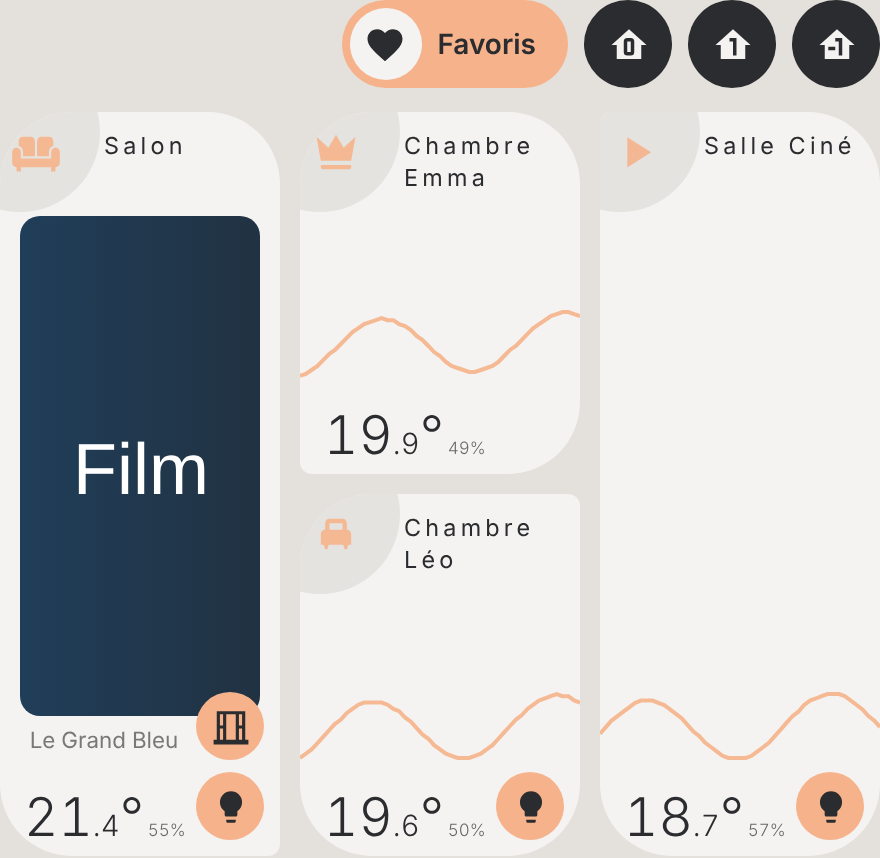
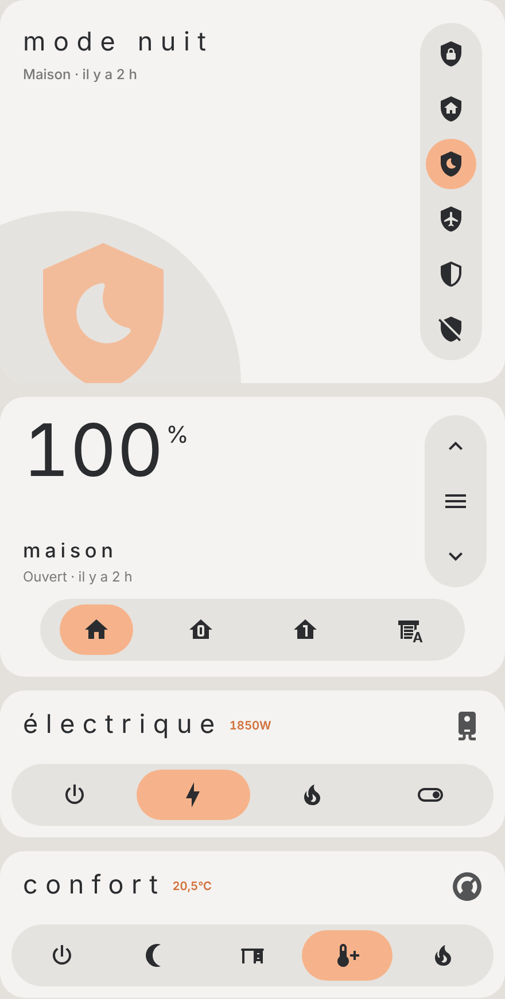
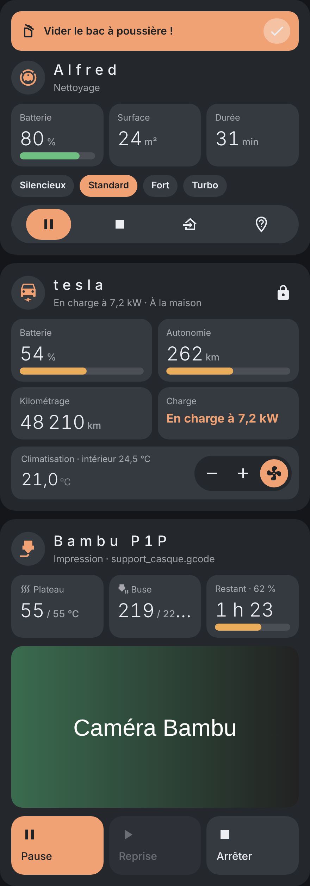
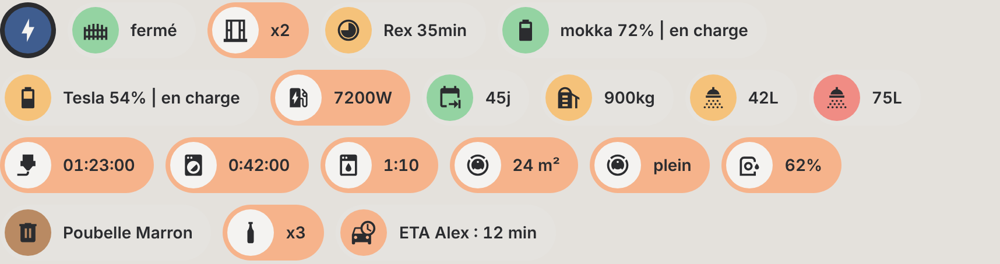
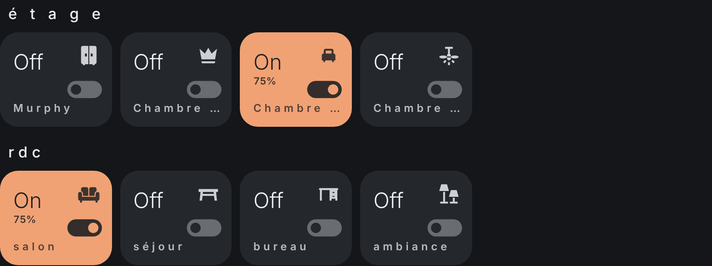
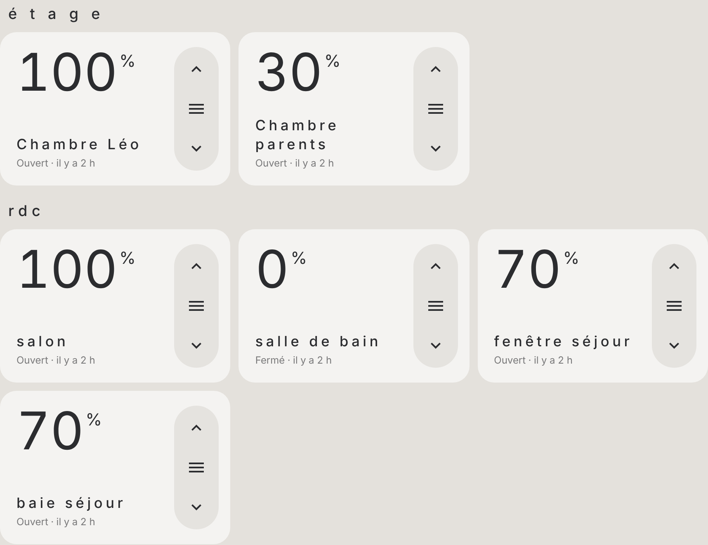
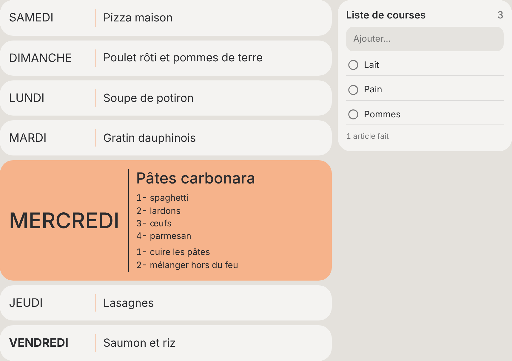
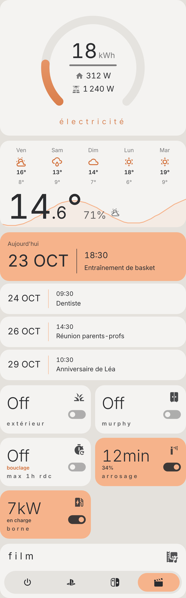
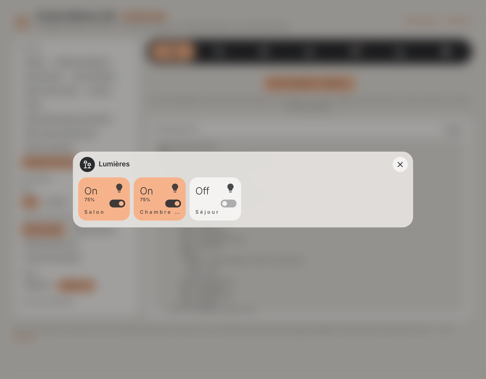

# Cartes Maison HA

**Dix-huit cartes Lovelace autonomes, dans un seul fichier**, pour construire un tableau de bord « maison » complet : pastilles d'état, pièces et plan par étage, lumières, volets, alarme, modes, aspirateur robot, voiture électrique, imprimante 3D, menu de la semaine, météo, agenda, jauges, titres de section, barre de navigation et fenêtres (pop-ups).

Elles remplacent les tableaux de bord construits avec **button-card** et ses modèles : plus besoin de button-card, decluttering-card, card-mod, bubble-card, layout-card, local-conditional-card, state-switch, mini-graph-card, mushroom, vacuum-card… **Une seule ressource**, un éditeur visuel pour chaque carte, et des entités **trouvées automatiquement** quand c'est possible.

**[▶ Essayer la démo en ligne](https://marlboro62.github.io/maison-ha-cards/docs/demo.html)** : toutes les cartes avec des données simulées, en clair ou sombre, sur téléphone ou PC, avec le YAML à copier.

| Plan par étage | Alarme, volets, modes | Robot, voiture, imprimante 3D |
| --- | --- | --- |
|  |  |  |

| Pastilles |
| --- |
|  |

| Lumières (sombre) | Volets |
| --- | --- |
|  |  |

| Menu de la semaine | Jauge, météo, agenda, interrupteurs | Fenêtre |
| --- | --- | --- |
|  |  |  |

*Aperçus réalisés avec des valeurs fictives.*

## Les cartes

| Type | Carte | Automatique |
| --- | --- | --- |
| `custom:maison-chips-card` | **Pastilles** : Tempo, portail, ouvertures, batteries, machines, poubelles… avec conditions d'affichage | Tempo, portail / garage, ouvertures, lumières allumées, alarme, robot, imprimante, piles faibles |
| `custom:maison-piece-card` | **Pièce** : température, humidité, courbe 24 h, ouvertures, lumières allumées, média en cours | tout, à partir de la pièce (`area`) |
| `custom:maison-plan-card` | **Plan** : les pièces par étage, onglets Favoris et étages, grille libre | étages et pièces de Home Assistant |
| `custom:maison-boutons-card` | **Lumières et interrupteurs** en tuiles On / Off | toutes les lumières, par étage |
| `custom:maison-volets-card` | **Volets** : position, montée, descente, curseur, stop, groupes avec sélecteur | tous les volets, par étage |
| `custom:maison-alarme-card` | **Alarme** : absent, présence, nuit, vacances, désarmée, avec clavier de code | la première alarme |
| `custom:maison-mode-card` | **Sélecteur de mode** : un `input_select` ou `select` en boutons (chauffage, ballon, activités…) | icônes devinées depuis les options |
| `custom:maison-robot-card` | **Aspirateur robot** : état, batterie, surface, durée, puissance, commandes, alerte « vider le bac » | le premier aspirateur et ses capteurs |
| `custom:maison-voiture-card` | **Voiture électrique** : batterie, autonomie, kilométrage, charge, climatisation, verrouillage | Tesla (Fleet, Teslemetry, Tessie, Tesla custom) |
| `custom:maison-imprimante-card` | **Imprimante 3D** : températures, avancement, temps restant, caméra, pause / reprise / arrêt | Bambu Lab, Moonraker (Klipper), OctoPrint |
| `custom:maison-menu-card` | **Menu de la semaine** : un jour par ligne, la recette du jour, la liste de courses | capteurs `sensor.menu_lundi…` |
| `custom:maison-meteo-card` | **Météo** : température en grand, prévisions, courbe 24 h | la première entité `weather` |
| `custom:maison-agenda-card` | **Agenda** : les prochains événements d'un ou plusieurs calendriers | le premier calendrier |
| `custom:maison-jauge-card` | **Jauge** en fer à cheval avec deux valeurs secondaires | — |
| `custom:maison-horloge-card` | **Horloge et menu** : heure en grand, date, menu de navigation vertical, lignes d'info (colonne latérale) | — |
| `custom:maison-titre-card` | **Titre de section**, avec la police et les couleurs du thème (remplace la carte Titre) | — |
| `custom:maison-navigation-card` | **Barre de navigation** fixée en bas de l'écran | — |
| `custom:maison-popup-card` | **Fenêtre** qui s'ouvre sur un lien `#…`, avec des cartes et des onglets | — |

L'énergie et Tempo ont leurs propres cartes : [Cartes Linky Énergie](https://github.com/Marlboro62/linky-energie-cards), [Carte Linky Appareils](https://github.com/Marlboro62/linky-appareils-card) et la mini-carte Tempo de la [Carte Enedis Linky New](https://github.com/Marlboro62/content-card-linky-new). Elles se placent très bien dans une fenêtre `maison-popup-card`.

## Installation

### Avec HACS (recommandé)

1. Dans HACS, menu **⋮** → **Dépôts personnalisés**.
2. Ajoutez `https://github.com/Marlboro62/maison-ha-cards` avec le type **Tableau de bord** (Dashboard).
3. Cherchez **Cartes Maison HA**, installez, puis rechargez la page (Ctrl+F5).

> Tant qu'il n'existe qu'une version bêta, activez **Afficher les versions bêta** dans la fenêtre de téléchargement de HACS.

### Manuellement

1. Téléchargez [`maison-ha-cards.js`](https://raw.githubusercontent.com/Marlboro62/maison-ha-cards/main/maison-ha-cards.js) (clic droit → Enregistrer sous) et copiez-le dans `/config/www/`.
2. **Paramètres → Tableaux de bord → ⋮ → Ressources → Ajouter une ressource** : URL `/local/maison-ha-cards.js`, type **Module JavaScript**.
3. Rechargez la page (Ctrl+F5).

Home Assistant **2024.4** ou plus récent (étages et pièces).

## Thèmes

Toutes les cartes acceptent `theme` :

| Valeur | Rendu |
| --- | --- |
| `maison` (défaut) | **Suit votre thème Home Assistant** (thème par défaut ou personnalisé, clair ou sombre) : fond des cartes, texte et pastilles reprennent `--card-background-color`, `--primary-text-color`…, avec des touches de couleur pastel. Si votre thème définit `--gray000`, `--gray200`, `--gray800`, `--active-pop`, `--active-green`…, ce sont ces couleurs qui sont utilisées. |
| `v2` | Style MyElectricalData bleu nuit |
| `auto` | Style MyElectricalData, clair ou sombre selon Home Assistant |
| `ha` | Couleurs du thème Home Assistant |

---

## Notions communes

### Textes avec valeurs `{…}`

Les noms, textes et infos acceptent des valeurs entre accolades :

| Écriture | Donne |
| --- | --- |
| `{state}`, `{unit}`, `{name}`, `{attr:nom}` | état, unité, nom ou attribut de l'entité de l'élément |
| `{sensor.x}`, `{climate.salon:temperature}` | état ou attribut d'une autre entité |
| `{state\|0}` `{state\|1}` | arrondi à 0 ou 1 décimale |
| `{state\|int}` | entier |
| `{state\|k\|1}` | divisé par 1000 (W → kW), 1 décimale |
| `{state\|hm}` `{state\|hms}` | minutes en « 1 h 05 » ou « 01:05:00 » |
| `{state\|date}` `{state\|time}` `{state\|rel}` | date, heure, « il y a 2 h » |
| `{state\|fr}` | état traduit (Ouvert, Fermé, En pause…) |

Exemple : `name: "Rex {state|int} min"`, `info: "{sensor.prise_ballon_power|int} W"`.

### Conditions

`show:` (pastilles), `levels:` (couleurs) et les textes conditionnels utilisent la même écriture. Sans `entity`, c'est l'entité de l'élément.

```yaml
show: { state: "on" }                       # état égal (ou liste d'états)
show: { state_not: ["0", "0:00:00"] }       # état différent
show: { above: 300 }                        # supérieur à / below: inférieur à
show: { entity: input_select.saison, state: hiver }
show: { after: "16:00" }                    # après 16 h (before: avant)
show:                                       # une liste = toutes les conditions
  - { entity: input_boolean.retour, state: "on" }
  - { entity: person.alex, state_not: home }
show: { or: [ { state: "on" }, { above: 0 } ] }
levels:                                     # première couleur dont la condition est vraie
  - { above: 60, color: green }
  - { above: 30, color: orange }
  - { color: red }
```

Couleurs : `green`, `orange`, `red`, `yellow`, `blue`, `blue-dark`, `purple`, `brown`, `pop` (couleur d'accent), `grey`, `white`, `black`, ou une couleur CSS (`#ff8800`).

### Actions

`tap_action` et `hold_action` comme dans Home Assistant : `toggle`, `more-info`, `navigate` (`navigation_path: "#lumieres"`), `perform-action` (`perform_action`, `target`, `data`), `url`, `none`. Un **appui long** ouvre en général la fiche de l'entité.

---

## Pastilles — `custom:maison-chips-card`

```yaml
type: custom:maison-chips-card
chips:
  - type: tempo                      # couleur du jour (rond) et du lendemain (fond)
  - type: gate
    entity: cover.portail            # vert si fermé, clic : ouvrir / fermer
  - type: count
    entity: sensor.nombre_ouvertures # « x2 », caché à 0
    icon: mdi:window-open-variant
  - type: battery
    entity: sensor.voiture_batterie
    label: Tesla
    charging: { entity: binary_sensor.voiture_en_charge, state: "on" }
  - type: timer
    entity: sensor.lave_linge_temps_restant   # caché à 0:00:00
    icon: mdi:washing-machine
  - type: bin
    entity: binary_sensor.poubelle_jaune_demain
    name: Poubelle jaune
    color: yellow
    after: "16:00"                   # visible la veille à partir de 16 h
  - entity: sensor.douche
    icon: mdi:shower-head
    name: "{state|int} L"
    show: { above: 0 }
    levels: [{ below: 31, color: green }, { below: 60, color: orange }, { color: red }]
```

Sans `chips:`, la carte affiche toute seule : Tempo, portails et garages, ouvertures, lumières allumées, alarme armée, robot en marche, impression 3D en cours et piles faibles.

| Type | Rôle |
| --- | --- |
| `tempo` | `entity` (couleur du jour) et `next` (lendemain), trouvés seuls avec RTE Tempo |
| `gate` | portail ou garage (`cover`) |
| `openings`, `lights`, `batteries` | nombre d'ouvertures, de lumières allumées, de piles sous `below` % (20 par défaut), sur `entities` ou sur toute la maison |
| `count` | nombre, caché à 0 |
| `timer` | temps restant, caché à 0 |
| `flag` | visible quand l'entité est `on` |
| `bin` | poubelle : visible quand `on`, après `after` |
| `battery` | icône et couleur selon le niveau, `label`, `charging`, `plugged` |
| `goal` | objectif atteint (`goal`: entité ou `target`: nombre), icône en camembert |
| `alarm`, `vacuum`, `printer` | alarme armée, robot en marche, impression en cours |
| *(sans type)* | pastille libre |

Options d'une pastille : `entity`, `name` (texte `{…}`, ou rien pour une pastille ronde), `icon`, `color` (rond), `levels`, `background`, `active` (fond d'accent), `show`, `states` (par état : `name`, `icon`, `color`, `active`, `hide`), `tap_action`, `hold_action`.
Options de la carte : `wrap` (`false` : une seule ligne qui défile), `align: center`.

## Pièce — `custom:maison-piece-card` et plan — `custom:maison-plan-card`

```yaml
type: custom:maison-piece-card
area: salon                  # tout le reste est trouvé dans la pièce
path: "#salon"               # clic : ouvre une fenêtre ou une vue
```

| Option | Rôle | Défaut |
| --- | --- | --- |
| `area` | Pièce Home Assistant (id ou nom) | — |
| `name`, `icon` | Nom (retour à la ligne avec `\n`) et icône | ceux de la pièce |
| `temperature`, `humidity` | Capteurs | ceux de la pièce |
| `doors` | Ouvertures : pastille si une est ouverte | portes et fenêtres de la pièce |
| `lights` | Lumières : pastille si une est allumée, clic : tout éteindre | lumières de la pièce |
| `media_player`, `media_image` | Lecteur : sa jaquette remplace la courbe pendant la lecture | lecteur de la pièce |
| `corner` | Coin carré : `bottom-right`, `bottom-left`, `top-right`, `top-left`, `none` | `bottom-right` |
| `graph` | Courbe de température sur 24 h | `true` |
| `color`, `background` | Couleur du rond et du fond | — |
| `path`, `tap_action`, `hold_action` | Actions | fiche de la température |

```yaml
type: custom:maison-plan-card
default: fav                    # onglet affiché à l'ouverture
favorites:                      # onglet Favoris (cœur), facultatif
  layout: |
    "salon chambre1 cine"
    "salon chambre2 cine"
  rows: 181px 181px
  rooms:
    - { area: salon, grid_area: salon }
    - { area: chambre_1, grid_area: chambre1, corner: bottom-left }
    - { area: chambre_2, grid_area: chambre2, corner: top-right }
    - { area: cinema, grid_area: cine, corner: top-left }
floors:
  - name: Rez-de-chaussée
    icon: mdi:home-floor-0
    rooms: [salon, cuisine, bureau]    # grille automatique de 3 colonnes
```

Sans `floors:`, la carte prend les **étages** et **pièces** de Home Assistant (celles qui ont une mesure, une lumière ou une ouverture). `layout` et `rows` suivent les grilles CSS (`grid-template-areas`) ; sans `layout`, chaque pièce peut prendre `span: 2` (deux fois plus haute) ou `wide: true`. `row_height` règle la hauteur d'une pièce (146 px).

## Lumières et interrupteurs — `custom:maison-boutons-card`

```yaml
type: custom:maison-boutons-card
sections:
  - title: é t a g e
    entities:
      - { entity: light.chambre, icon: mdi:bed, name: chambre }
  - title: jardin
    entities:
      - entity: input_boolean.arrosage
        icon: mdi:sprinkler
        text_on: "{counter.arrosage_restant} min"
        info: "{sensor.humidite_du_sol}%"
      - entity: switch.borne
        icon: mdi:ev-station
        text_on:
          - { if: { entity: sensor.borne_puissance, above: 100 }, text: "{sensor.borne_puissance|k|1} kW" }
          - Attente
```

Sans `entities` ni `sections`, toutes les lumières, rangées par étage. Clic : marche / arrêt, appui long : fiche (luminosité, couleur). Par entité : `name`, `icon`, `color` (fond allumé), `text_on`, `text_off`, `info` (petit texte), `tap_action`, `hold_action`. Carte : `columns`, `title`, `tile`.

`tile: carre` : tuiles carrées avec l'icône en haut, le nom espacé et l'état en petit (« activé », « désactivé » ou `text_on` / `text_off`) ; allumée, la tuile prend un fond d'accent doux et l'icône se colore.

## Volets — `custom:maison-volets-card`

```yaml
type: custom:maison-volets-card
sections:
  - title: rdc
    entities:
      - { entity: cover.salon, name: salon }
```

Boutons monter / curseur / descendre ; **appui long** sur le bouton du milieu : stop. Sans `entities`, tous les volets par étage.
**Groupes** avec un sélecteur (un seul grand volet et une barre d'onglets) :

```yaml
type: custom:maison-volets-card
select: input_select.mode_volets     # facultatif : l'onglet suit et modifie cet input_select
tabs:
  - { name: maison, option: maison, icon: mdi:home, entity: cover.tous_les_volets }
  - { name: rdc, option: rdc, icon: mdi:home-floor-0, entity: cover.volets_rdc }
```

Options : `columns`, `slider` (`false` : pas de curseur).

## Alarme — `custom:maison-alarme-card`

```yaml
type: custom:maison-alarme-card
entity: alarm_control_panel.maison
modes: [away, night, vacation, disarm]   # par défaut : selon ce que l'alarme sait faire
```

`code` (sinon un clavier s'affiche quand l'alarme demande un code), `name`, `state_names` (libellés par état), `tap_action`. La carte devient rouge et clignote quand l'alarme est déclenchée.

## Sélecteur de mode — `custom:maison-mode-card`

```yaml
type: custom:maison-mode-card
entity: input_select.mode_ballon
icon: mdi:water-boiler
options:
  - { option: "off", icon: mdi:power }
  - { option: électrique, icon: mdi:lightning-bolt, info: "{sensor.prise_ballon_power|int}W" }
  - { option: marche forcée, name: manuel, icon: mdi:toggle-switch-outline }
```

Sans `options`, toutes celles de l'entité, avec une icône devinée (off, nuit, confort, éco, hors-gel, vacances, turbo, auto, été, hiver, film, PS5…). `info` (texte à côté du nom, pour toutes les options), `name`, `subtitle`, `hide_options`, couleur par option (`color`).

## Aspirateur robot — `custom:maison-robot-card`

```yaml
type: custom:maison-robot-card
entity: vacuum.robot
alert: input_boolean.vider_bac      # bandeau « Vider le bac » tant qu'il est on
```

`battery`, `area`, `duration` (trouvés sur l'appareil du robot), `alert_text`, `name`, `icon`, `show_fan_speed`.

## Voiture électrique — `custom:maison-voiture-card`

```yaml
type: custom:maison-voiture-card
name: tesla
battery: sensor.tesla_battery       # le reste est trouvé sur le même appareil
```

`range`, `odometer`, `charging` (binary_sensor ou état de charge texte), `plugged`, `charger_power`, `charge_limit`, `climate`, `inside_temp`, `lock` (déverrouillage en deux clics), `location`, `charge_switch`, `prefix`, `icon`.

## Imprimante 3D — `custom:maison-imprimante-card`

```yaml
type: custom:maison-imprimante-card
name: Bambu P1P
prefix: p1p_01p00a000000000          # facultatif si une seule imprimante
```

`progress`, `remaining`, `stage`, `file`, `bed`, `nozzle`, `bed_target`, `nozzle_target`, `pause`, `resume`, `stop` (arrêt en deux clics), `camera`, `cover`, `camera_view` (`live` ou `image`), `show_camera`.

## Menu de la semaine — `custom:maison-menu-card`

```yaml
type: custom:maison-menu-card
todo: todo.liste_de_courses
first_day: samedi
```

Les capteurs `sensor.menu_lundi`, `…_mardi`… (nom libre contenant « menu » et le jour) sont trouvés seuls, sinon `days: [{ day: lundi, entity: sensor.… }]`. Le nom de la recette, les ingrédients et les étapes viennent des attributs `recette_nom`, `recette_ingredients`, `recette_details` (`name_attribute`, `ingredients_attribute`, `details_attribute` pour d'autres noms). `day_entity` : un `input_select` qui garde le jour choisi. La liste de courses permet de cocher et d'ajouter des articles.

## Météo, agenda et jauge

```yaml
type: custom:maison-meteo-card
entity: weather.maison
temperature: sensor.temperature_exterieure   # facultatif, sinon celle de la météo
humidity: sensor.humidite_exterieure
days: 5                                      # forecast_type: daily ou hourly
```

```yaml
type: custom:maison-agenda-card
entities: [calendar.famille, calendar.ecole]
max: 4          # nombre d'événements
days: 30        # sur combien de jours
```

Un capteur qui porte une liste `events` en attribut est aussi accepté.

```yaml
type: custom:maison-jauge-card
entity: sensor.energie_du_jour
name: électricité
max: 30
secondary:
  - { entity: sensor.puissance_maison, icon: mdi:home }
  - { entity: sensor.puissance_solaire, icon: mdi:solar-power-variant }
```

## Horloge et menu — `custom:maison-horloge-card`

```yaml
type: custom:maison-horloge-card
items:                                   # menu vertical : l'entrée de la page ouverte est surlignée
  - { name: home, icon: mdi:dots-grid, path: /tableau-maison/home }
  - { name: cctv, icon: mdi:cctv, path: /tableau-maison/cctv }
  - { name: consos, icon: mdi:chart-areaspline, path: /energy }
  - { name: extra, icon: mdi:star-plus, path: "#extra" }
info:                                    # lignes sous le menu (textes {…}, show:)
  - { icon: mdi:washing-machine, text: "{sensor.lave_linge_temps_restant} restant", entity: sensor.lave_linge_temps_restant, show: { state_not: "0:00:00" } }
```

L'heure se met à jour à chaque minute, la date est en toutes lettres (`show_date: false` pour la masquer). Placée dans la première colonne d'une vue « sections », elle forme une colonne latérale.

## Ombres

Les cartes, les tuiles carrées et les pièces du plan prennent l'ombre définie par `--maison-shadow` dans votre thème (aucune par défaut). Exemple : `--maison-shadow: 0 4px 14px rgba(30, 40, 60, .10)`. `--active-on-pop` règle la couleur du texte posé sur la couleur d'accent.

## Police

Les cartes prennent la police du thème (`--ha-font-family-body`), y compris un thème appliqué à une seule vue (`theme:` de la vue). Exemple, avec une police déclarée par une ressource CSS : `ha-font-family-body: "'Ma police', Roboto, sans-serif"`.

Pour une police large (tout en majuscules, par exemple), trois réglages du thème évitent que les noms soient coupés :

| Variable | Rôle | Défaut |
| --- | --- | --- |
| `maison-font-scale` | Taille des petits textes (noms et états des tuiles, jours de la météo, date, heure de l'agenda) | `1` |
| `maison-letter-spacing` | Espacement des lettres des noms et états des tuiles | celui de la carte |
| `maison-font-synthesis` | `none` : pas de faux gras quand la police n'a qu'une graisse (le faux gras élargit le texte) | `auto` |

Exemple : `maison-font-scale: "0.8"`, `maison-letter-spacing: "0.02em"`, `maison-font-synthesis: none`.

## Titre de section — `custom:maison-titre-card`

Remplace la carte Titre (`heading`) de Home Assistant. Celle-ci garde la police de l'interface même quand un thème est appliqué à la vue ; la carte Titre Maison prend celle du thème.

```yaml
type: custom:maison-titre-card
title: l a m p e s
icon: mdi:lightbulb-group   # facultatif
style: title                # title (défaut) ou subtitle
tap_action:                 # facultatif
  action: navigate
  navigation_path: /lumieres
```

## Barre de navigation — `custom:maison-navigation-card`

```yaml
type: custom:maison-navigation-card
items:
  - { icon: mdi:lamps-outline, path: "#lumieres" }
  - { icon: mdi:robot-vacuum, path: "#robot", badge: { entity: input_boolean.vider_bac, state: "on", color: red } }
  - { icon: mdi:chart-bar, path: /energy }
```

Fixée en bas de l'écran (`position: inline` pour la garder dans la page). L'icône de la page ou de la fenêtre ouverte est mise en avant ; `badge` affiche un point selon une condition.

## Fenêtre — `custom:maison-popup-card`

```yaml
type: custom:maison-popup-card
hash: "#lumieres"
title: Lumières
icon: mdi:lamps-outline
width_desktop: 70%
cards:
  - type: custom:maison-boutons-card
```

Toute carte qui navigue vers `#lumieres` (barre de navigation, pastille, pièce…) ouvre la fenêtre. Fermeture par la croix, la touche Échap ou un clic à côté (`close_on_click_outside: false` pour l'empêcher). Options : `tabs` (onglets : `[{ name, icon, cards }]` à la place de `cards`), `auto_close` (ms), `open_action`, `close_action`. En mode édition, la fenêtre s'affiche dans la page pour être modifiée.

---

## Passer d'un tableau de bord button-card à ces cartes

| Avant | Maintenant |
| --- | --- |
| `chips_big`, `chips_big_active` + `styles: display: [[[ … ]]]` | une pastille avec `show:` et `active: true` |
| `room_card` + mini-graph-card + mini-media-player + mushroom-chips | `maison-piece-card` |
| `layout-card` + `local-conditional-card` (onglets d'étage) | `maison-plan-card` |
| `my_light_card`, `light_toggle`, `button_toggle` | `maison-boutons-card` |
| `hc_blind_card` + my-slider-v2 + `input_boolean.cover_slider` | `maison-volets-card` |
| `hc_security_card` | `maison-alarme-card` |
| `hc_select_card` et ses quatre boutons | `maison-mode-card` |
| `my_menu_card` + state-switch | `maison-menu-card` |
| vacuum-card | `maison-robot-card` |
| `sensor_big`, `sensor_big_percentage` (voiture, imprimante) | `maison-voiture-card`, `maison-imprimante-card` |
| flex-horseshoe-card | `maison-jauge-card` |
| mod-card de navigation | `maison-navigation-card` |
| bubble-card `pop-up` | `maison-popup-card` |

Un exemple complet est dans [`exemples/`](exemples/).

## Support

Questions et problèmes : uniquement via les [issues GitHub](https://github.com/Marlboro62/maison-ha-cards/issues).

## Voir aussi

[Cartes Serveur HA](https://github.com/Marlboro62/serveur-ha-card) · [Carte Onduleur UPS](https://github.com/Marlboro62/onduleur-ups-card) · [Cartes Linky Énergie](https://github.com/Marlboro62/linky-energie-cards) · [Carte Enedis Linky New](https://github.com/Marlboro62/content-card-linky-new)

Si les cartes vous sont utiles : [Buy Me a Coffee](https://buymeacoffee.com/marlboro62) · [Ko-fi](https://ko-fi.com/nothing_one)

## Licence

MIT
